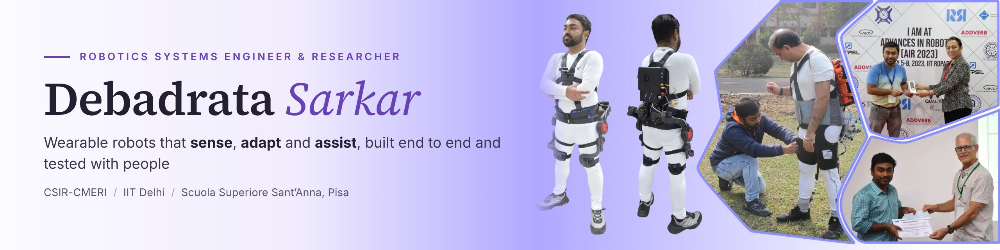
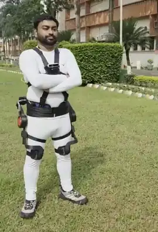
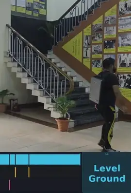
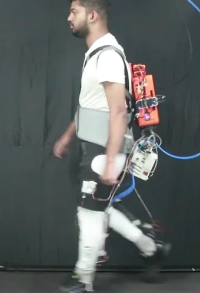
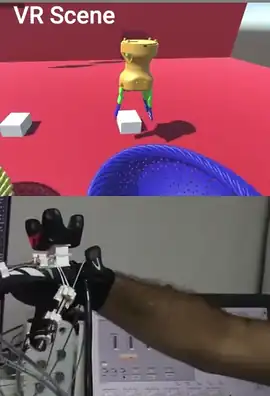
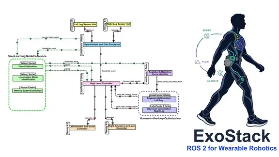

<!-- Profile README for github.com/debadrata, generated by build_readme.py -->

  
  
  
  
  

I build wearable robots end to end, from actuators, sensing and embedded control to ROS&nbsp;2 software and learned estimators, and I test them with people. My research combines scene understanding with proprioceptive sensing for adaptive, intelligent control of wearable robots, personalizes their assistance through human-in-the-loop optimization, and fuses multimodal haptic feedback into collaborative robots to enrich shared autonomy.

<table>
  <tr>
    <td align="center" width="25%"></td>
    <td align="center" width="25%"></td>
    <td align="center" width="25%"></td>
    <td align="center" width="25%"></td>
  </tr>
  <tr>
    <td align="center" valign="top"><a href="https://dsarkarrobotics.com/research/xonav/"><b>XoNav</b></a> Hip exoskeleton that guides navigation through personalized haptic cues</td>
    <td align="center" valign="top"><a href="https://dsarkarrobotics.com/research/tread/"><b>Tread</b></a> Causal, probabilistic terrain and locomotion context for gait-phase estimation</td>
    <td align="center" valign="top"><a href="https://dsarkarrobotics.com/research/soft-exowalk/"><b>SoftEXOwalk</b></a> Self-sensing pSTAMs drive human-in-the-loop personalization</td>
    <td align="center" valign="top"><a href="https://dsarkarrobotics.com/research/haptic-glove/"><b>Soft haptic glove</b></a> Multimodal haptic feedback: fingertip tactile and kinesthetic</td>
  </tr>
</table>

<table>
  <tr>
    <td width="44%" valign="middle"></td>
    <td valign="middle">
      <b>OPEN SOURCE · FEATURED</b> 
      <a href="https://github.com/debadrata/ExoStack"><b>ExoStack</b></a>: a modular, reconfigurable ROS&nbsp;2 framework for wearable robots 
      
      
        
      <b>ALSO OPEN SOURCE</b> 
      <a href="https://github.com/debadrata/Tread"><b>Tread</b></a>: context-aware visuo-inertial gait-phase and speed estimation 
      <a href="https://github.com/debadrata/pSTAM-Design-Toolbox"><b>pSTAM Design Toolbox</b></a>: neural-surrogate actuator design
    </td>
  </tr>
</table>

<table>
  <tr><td valign="middle"><nobr><b>Robotics &amp; simulation</b></nobr></td><td valign="middle">      </td></tr>
  <tr><td valign="middle"><nobr><b>Robots &amp; actuators</b></nobr></td><td valign="middle">     </td></tr>
  <tr><td valign="middle"><nobr><b>Learning &amp; control</b></nobr></td><td valign="middle">         </td></tr>
  <tr><td valign="middle"><nobr><b>Embedded &amp; sensing</b></nobr></td><td valign="middle">      </td></tr>
  <tr><td valign="middle"><nobr><b>Gait lab &amp; human trials</b></nobr></td><td valign="middle">       </td></tr>
  <tr><td valign="middle"><nobr><b>Design &amp; FEA</b></nobr></td><td valign="middle">   </td></tr>
  <tr><td valign="middle"><nobr><b>Languages</b></nobr></td><td valign="middle">      </td></tr>
</table>

<b>Selected publications, patents and awards</b>

- **SoftEXOwalk:** a human-in-the-loop optimized soft exosuit for assisting knee flexion using sensorized pneumatic muscles. *IEEE Trans. Medical Robotics and Bionics*, 2026. [DOI](https://doi.org/10.1109/TMRB.2026.3722336)
- **XoNav:** an exoskeleton as a personalized haptic interface for assisted navigation. Under review, *IEEE RA-L*. [arXiv](https://arxiv.org/abs/2610.27271)
- **Tread:** a visuo-inertial framework for terrain- and locomotion-context-aware gait-phase and speed estimation. Under review, *IEEE Sensors Journal*. [arXiv](https://arxiv.org/abs/2610.19067) · [code](https://github.com/debadrata/Tread)
- **ExoStack:** a modular and reconfigurable software framework for wearable robotics using ROS&nbsp;2. Under review, *IEEE RA-P*. [code](https://github.com/debadrata/ExoStack) · [docs](https://debadrata.github.io/ExoStack_documentation/)
- **A soft glove with proprioceptive sensing and multi-modal haptic feedback** for VR and telerobotics. *Journal of Bionic Engineering*, 2025. [DOI](https://doi.org/10.1007/s42235-024-00642-z)
- **Patents:** low-pressure silicone-bladder pneumatic artificial muscle, Indian Patent No. 604983 (granted 2026); two-stage pneumatic supply for untethered actuation, [US 2024/0309891 A1](https://patents.google.com/patent/US20240309891A1/en).
- **Awards:** Best Paper (oral presentation), AIR 2019, IIT Madras · Best Poster, AIR 2023, IIT Ropar.

Full list on [Google Scholar](https://scholar.google.com/citations?user=a5w-W7UAAAAJ) and the [portfolio](https://dsarkarrobotics.com/publications/).

<b>Research path</b>

<table>
  <tr><td valign="top"><nobr><b>2026-now</b></nobr></td><td><b>Research Project Scientist, Human-Centred Robotics and Cybernetics Group, CSIR-CMERI, Durgapur</b> · ICMR-funded Building a hip exoskeleton that guides navigation through personalized haptic cues, visuo-inertial terrain- and context-aware gait estimation, and an open ROS&nbsp;2 framework for wearable robots.</td></tr>
  <tr><td valign="top"><nobr><b>2024-2026</b></nobr></td><td><b>Senior Project Scientist, Department of Applied Mechanics, IIT Delhi</b> · DRDO-funded Developed tendon-driven elbow and ankle exoskeletons with biosignal-based admittance control and gait-event-triggered assistance, and a gait-lab testbed that synchronizes the exosuit with treadmill, motion capture, EMG and metabolic measurement.</td></tr>
  <tr><td valign="top"><nobr><b>2019-2023</b></nobr></td><td><b>Project Assistant, Robotics and Automation Group, CSIR-CMERI, Durgapur</b> · DRDO-funded Core member of a soft knee exosuit programme from its inception: pneumatic muscles, embedded soft sensing, learned force estimation, HIL personalization and human trials; also a haptic VR glove, an aerial soft manipulator and an endoscopic steering head (Indo-Korea Joint Network Centre on Robotics).</td></tr>
  <tr><td valign="top"><nobr><b>2018</b></nobr></td><td><b>Summer research intern, Neuro-Robotic Touch Laboratory (Prof. Calogero M. Oddo), The BioRobotics Institute, Scuola Superiore Sant’Anna, Pisa</b> Designed, cast and tested a pneumatic fingertip tactile display for haptic feedback in robot-assisted surgery.</td></tr>
  <tr><td valign="top"><nobr><b>2015-2019</b></nobr></td><td><b>B.Tech. in Mechanical Engineering, NIT Durgapur</b> CGPA 9.30/10, ranked 5 of 126. Thesis on soft bending actuators, Best Paper at AIR 2019.</td></tr>
</table>

